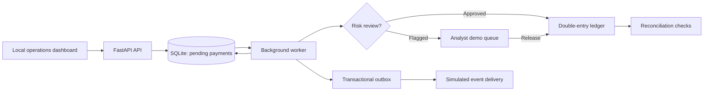
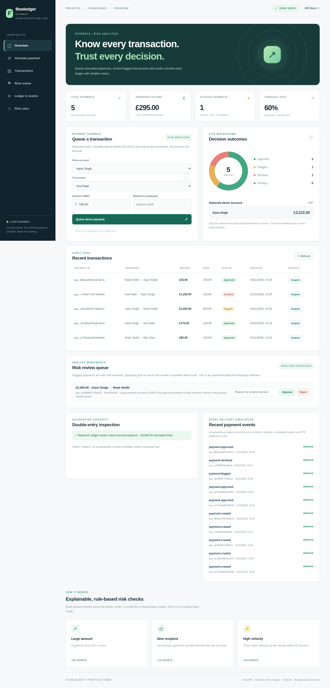

# FlowLedger | Payment Infrastructure Lab

A **local-only fintech backend portfolio project** with a durable payment queue, double-entry ledger, risk review and a simulated transactional event outbox. Built using Python, FastAPI, SQLite and a lightweight JavaScript operations dashboard.

> ⚠️ **Fictional money only.** No real payments, bank integrations or customer data. The web dashboard deliberately has **no user login or permission enforcement** and is intended for **localhost use only**. It is **not** a deployable financial service.

## Engineering highlights

| Feature | Why it matters |
|---|---|
| Queued payments | `POST /api/payments` persists a `pending` record, then a background worker settles it separately. Pending work survives restarts. |
| Idempotent submissions | Reuse of the same key + same request returns the existing payment; changing the details returns HTTP 409. |
| Double-entry accounting | Approved transfers create one negative and one positive ledger entry in the same SQL transaction as both balance changes. |
| Safe concurrent spending | `BEGIN IMMEDIATE` serialises writers before reading funds, avoiding double spending within one SQLite database. |
| Explainable risk rules | High value, first-time recipients and rapid attempts contribute to an illustrative risk score. |
| Manual risk review | Flagged payments remain on hold. Analyst approve/reject decisions are audited; approvals recheck available funds. |
| Transactional outbox | Payment lifecycle events are stored alongside state changes and then marked as **simulated deliveries** by a worker. No real webhooks are emitted. |
| Reconciliation | `/api/reconciliation` checks all transfer pairs, every account's cached balance against its entries, and the total money supply. |
| Regression and stress tests | Automated tests cover state transitions, concurrency, fraud review, ledger invariants and corrupt-data detection. |

## Run it locally

Requires **Python 3.10+**.

```bash
python3 -m venv .venv
source .venv/bin/activate                # Windows: .venv\\Scripts\\activate
pip install -r requirements.txt
uvicorn app.main:app --reload
```

Open **http://127.0.0.1:8000** for the operations dashboard and **http://127.0.0.1:8000/docs** for the auto-generated API docs.

The first launch seeds four fictional accounts and five sample payments. It creates `data/flowledger.sqlite3` automatically, which is excluded from Git. For a fresh demo, stop the server, remove the local `.sqlite3` file (and any `-wal`/`-shm` files), then restart. **This deletes all local demo history.**

### Test and stress test

```bash
pip install -r requirements-dev.txt
python -m pytest -q
python -m scripts.stress_test
```

The stress test submits 80 concurrent in-process requests, drains the worker queue and asserts that the ledger reconciles. Its timings are **local lab timings**, not production performance figures.

## Example API workflow

**1. Queue a payment** (response: `202 Accepted`, with status `pending`):

```bash
curl -X POST http://127.0.0.1:8000/api/payments \\
  -H 'Content-Type: application/json' \\
  -d '{
    "sender_id":"acct_ava",
    "recipient_id":"acct_noah",
    "amount":"25.00",
    "note":"Demo invoice",
    "idempotency_key":"readme-demo-transfer-001"
  }'
```

**2. Check its status** using `GET /api/payments/{id}`. A local worker normally processes queued work within about a second. Its result may be `approved`, `flagged` or `declined`.

**3. Review a flagged payment** using the dashboard or `POST /api/reviews/{id}`:

```json
{"decision":"approve", "note":"Reviewed simulated activity"}
```

**4. Inspect payment accounting** using `GET /api/payments/{id}/ledger`, audit events using `GET /api/payments/{id}/audit`, and the full integrity check using `GET /api/reconciliation`.

### API endpoints

| Method | Endpoint | Purpose |
|---|---|---|
| GET | `/api/accounts` | Lists fictional account IDs and names, not their balances |
| GET | `/api/demo/balance/{account_id}` | Shows one selected demo account balance, **not secure identity access** |
| POST | `/api/payments` | Enqueue or idempotently retry a payment |
| GET | `/api/payments` | Recent payments |
| GET | `/api/payments/{id}` | Payment status |
| GET | `/api/payments/{id}/ledger` | Both ledger entries for approved transfer |
| GET | `/api/payments/{id}/audit` | Payment lifecycle and review audit |
| GET | `/api/reviews` | Payments awaiting a simulated review |
| POST | `/api/reviews/{id}` | Approve or reject a flagged payment |
| GET | `/api/events` | Outbox queue and simulated deliveries |
| GET | `/api/reconciliation` | Cross-check ledger vs account balances |
| POST | `/api/demo/worker/tick` | Process queued work manually for demo/testing |
| GET | `/api/stats` | Status counts and approved transfer volume |

### Architectural overview



**Payment state model:** `pending → approved / flagged / declined`; a flagged payment may be manually released (`approved`) or rejected (`declined`). Status updates, balances, ledger entries and audit events commit atomically in SQLite.

**Risk rules:** Amount ≥ £2,000 = +65 points; first approved recipient = +15; three other attempts within 60 seconds = +65. Scores ≥ 60 are held for review. These are *illustrative business rules*, not risk probabilities or an ML model.

**Money:** All balances and ledger entries are **integer pence**. The API accepts precise decimal GBP strings and rejects sub-penny values. Each approved transfer creates a negative entry for the sender and a matching positive entry for the recipient. Database triggers prevent updating or deleting existing ledger and audit rows in the demo.

## Source layout

```text
app/
  database.py             SQL schema, transactions, risk, review, outbox, reconciliation
  main.py                 FastAPI routes and background worker
  static/                 Responsive dashboard, review controls, event/ledger inspector
tests/test_payments.py    Functional and concurrency regression tests
scripts/stress_test.py   Repeatable 80-request local concurrency scenario
docs/LEARNING_GUIDE.md   Guided walkthrough and interview explanations
.github/workflows/      GitHub Actions pytest check
requirements*.txt
```

## Limitations, security and honesty

- **Local sandbox only:** No authentication, RBAC, encryption/key management, bank connectivity, real customer data, anti-fraud training, KYC, PCI or financial regulatory compliance. The "analyst" view is a **simulation**, not an access-controlled interface.
- **Database:** SQLite and an in-process worker provide useful single-machine learning examples, **not distributed fault-tolerance, high availability or production throughput**. One live service process is the intended configuration.
- **Outbox:** Events are marked delivered **locally** rather than sent to a third-party webhook. Real delivery would require consumers, retries, signatures and de-duplication.
- **Ledger:** Immutable append-only entries are enforced by SQLite triggers; real-world systems need additional controls, reconciliation processes, operational auditability and independent security review.
- **Project authorship:** Built with AI assistance for learning. Review and explain the code before describing it as personal engineering experience on a CV or in interviews.

## Study next

Read [the learning guide](docs/LEARNING_GUIDE.md), then try adding a new risk rule, a real role-based access layer (for a *separate* learning project), or a PostgreSQL version with safe concurrent row locking.

### Dashboard preview


